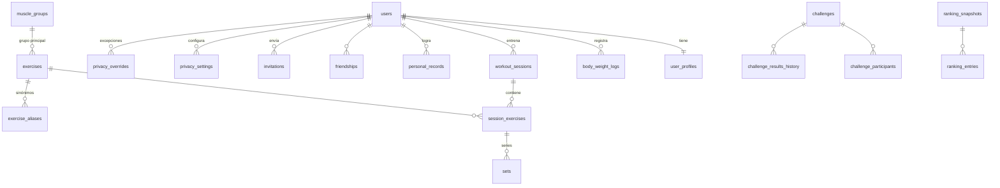
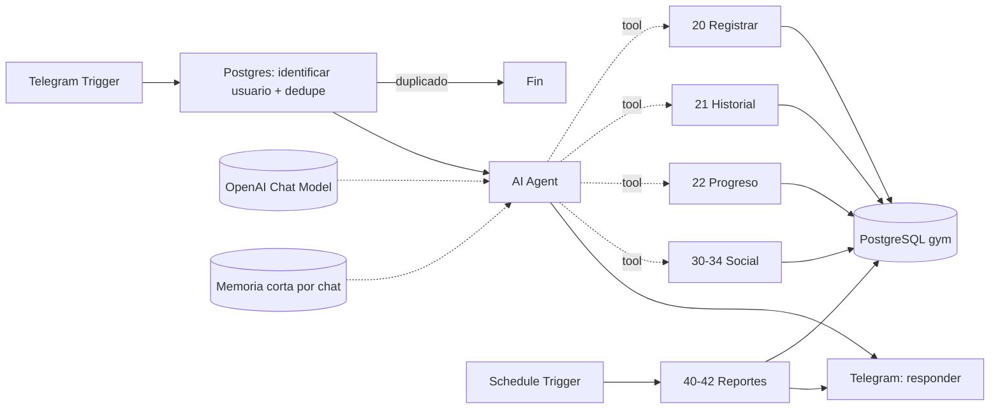

# GymProcess · Arquitectura

## 1. Arquitectura general

```
 Telegram ──► n8n: 10 · Router/Agente (AI Agent + memoria corta)
                │   el LLM SOLO decide qué herramienta usar y redacta la respuesta
                │
                ├── tool ► 20 · Registrar entrenamiento ─┐
                ├── tool ► 21 · Última sesión / historial│
                ├── tool ► 22 · Progreso y estadísticas  │   sub-workflows
                ├── tool ► 30 · Perfil y peso corporal   ├── (Execute Workflow Trigger)
                ├── tool ► 31 · Amigos e invitaciones    │   reciben user_id del router,
                ├── tool ► 32 · Comparar con amigo       │   NUNCA del LLM
                ├── tool ► 33 · Retos                    │
                └── tool ► 34 · Rankings ────────────────┘
                                   │
                                   ▼
                     PostgreSQL "gym"  (funciones SQL: permisos, e1RM, dedupe)

 Cron ──► 40 · Resúmenes semanales/mensuales · 41 · Cierre de retos · 42 · Recordatorios
```

Principios:

1. **El LLM nunca escribe SQL ni elige el `user_id`.** El router identifica al usuario por su `telegram_id`
   y lo inyecta en cada herramienta. Así un usuario no puede pedir los datos de otro "engañando" al modelo.
2. **Reglas críticas en la base de datos**, no en el prompt: `fn_can_view()` (privacidad), restricciones
   `UNIQUE` (duplicados), `CHECK` (valores imposibles), `f_e1rm()` (métricas consistentes).
3. **Extracción estructurada → validación → confirmación → escritura.** El LLM convierte el texto en JSON;
   un nodo Code lo valida; si hay ambigüedad se pregunta antes de guardar.
4. **Un workflow por capacidad.** Cada uno se prueba aislado y luego se conecta al agente como tool.
5. **Idempotencia.** `message_log(update_id)` evita procesar dos veces un reintento de Telegram;
   `workout_sessions(source_message_id)` evita registrar dos veces el mismo entrenamiento.

## 2. Tecnologías y por qué

| Pieza | Elección | Motivo |
|---|---|---|
| Orquestación | **n8n self-hosted (Docker)** | Gratis, control total, nodo AI Agent nativo, sub-workflows como tools. n8n Cloud también vale. |
| Interfaz | **Telegram** | API gratuita, sin aprobación de Meta, comandos y botones inline, enlaces de invitación `t.me/bot?start=TOKEN`. WhatsApp queda como canal futuro (columna `users.whatsapp_id` ya reservada). |
| LLM | **OpenAI `gpt-4.1-mini`** (o compatible: Claude, Gemini, modelo local vía Ollama) | Buen tool-calling y salida JSON a bajo coste. El modelo se cambia en un solo nodo. |
| Base de datos | **PostgreSQL 16** desde el inicio | Ver abajo. |
| Túnel local | **cloudflared** (opcional) | Telegram exige webhook HTTPS público. |

### ¿Google Sheets o PostgreSQL? → PostgreSQL desde el día 1

Google Sheets sirve para un único usuario, pero falla justo en lo que pide este proyecto:

- **Multiusuario + privacidad**: Sheets no tiene permisos por fila; cualquier workflow que lea la hoja ve todo.
  Postgres permite `fn_can_view()` y, más adelante, Row Level Security.
- **Integridad**: sin claves foráneas, `UNIQUE` ni transacciones → duplicados y series huérfanas.
- **Consultas analíticas**: rankings, % de mejora, e1RM por periodo, rachas… son `JOIN` + funciones de ventana;
  en Sheets serían decenas de nodos Code frágiles.
- **Límites**: cuotas de la API de Google (60 lecturas/min/usuario) y latencia de 1-3 s por llamada.
- **Futuro**: una app web/móvil o un panel (Metabase, Grafana, Supabase) se conecta directo a Postgres.

Si prefieres no administrar servidor, el mismo esquema funciona tal cual en **Supabase** o **Neon** (plan gratuito).

## 3. Modelo de datos

Archivos: [`db/sql/001_schema.sql`](../db/sql/001_schema.sql), [`002_functions_views.sql`](../db/sql/002_functions_views.sql), [`003_seed.sql`](../db/sql/003_seed.sql).



| Bloque | Tablas | Notas clave |
|---|---|---|
| Usuarios | `users`, `user_profiles`, `body_weight_logs` | `telegram_id` identifica; `username` e `invite_code` para que te agreguen; peso corporal con historial para fuerza relativa. |
| Catálogo | `muscle_groups`, `exercises`, `exercise_muscle_groups`, `exercise_aliases`, `muscle_group_aliases` | Normalización: "banca", "bench", "press de banca" → *Press banca*. Búsqueda exacta y difusa (`pg_trgm`). |
| Entrenamiento | `workout_sessions` → `session_exercises` → `sets` | Sesión por día; series individuales con peso, reps, RPE. "Última sesión" = última `session_date` que contiene ese grupo. |
| Récords | `personal_records` | Historial de PR (peso máx., e1RM, reps, volumen) para avisar "¡nuevo récord!". |
| Social | `friendships`, `invitations` | Una fila por pareja (`user_low_id < user_high_id`), estado `pending/accepted/blocked`. Invitación por username, código o enlace con token y caducidad. |
| Privacidad | `privacy_metrics`, `privacy_settings`, `privacy_overrides` | Por métrica: `nobody/friends/everyone` + excepciones por amigo. Por defecto: métricas agregadas → amigos; detalle de sesiones → nadie. |
| Competencia | `challenges`, `challenge_participants`, `challenge_results_history`, `ranking_snapshots`, `ranking_entries` | Reto con métrica, fechas, reglas JSON, línea base por participante e historial de cálculos. |
| Operación | `message_log` | Idempotencia y auditoría. |

### Comparaciones justas (se implementan en Fase 7-8)

- **Fuerza relativa** = e1RM / peso corporal (requiere `body_weight_logs` reciente).
- **Mejora porcentual** = (mejor e1RM del periodo − línea base) / línea base. Premia el progreso, no el tamaño.
- **Puntuación DOTS** (estándar de powerlifting que normaliza por peso y sexo) para sentadilla/banca/muerto.
- **Consistencia** = semanas con ≥ N sesiones / semanas del periodo.
- Cada ranking muestra **periodo, métrica, fórmula y quién quedó excluido** (por privacidad o datos insuficientes).

## 4. Workflows de n8n

| # | Workflow | Disparador | Fase |
|---|---|---|---|
| 00 | DB Healthcheck | Manual | 1 |
| 01 | Telegram Ping | Telegram | 1 |
| 10 | Router / Agente | Telegram | 2 |
| 20 | Registrar entrenamiento | Tool del agente | 3 |
| 21 | Historial / última sesión | Tool | 4 |
| 22 | Progreso y estadísticas | Tool | 5 |
| 30 | Perfil y peso corporal | Tool | 6 |
| 31 | Amigos, invitaciones, privacidad | Tool | 7 |
| 32 | Comparar con amigo | Tool | 7 |
| 33 | Retos (crear, unirse, estado) | Tool | 8 |
| 34 | Rankings | Tool | 8 |
| 40-42 | Resúmenes, cierre de retos, recordatorios | Cron | 9 |
| 99 | Manejador de errores | Error Trigger | 10 |



## 5. Fases

| Fase | Entregable | Prueba de aceptación |
|---|---|---|
| 1 | Docker n8n+Postgres, esquema, bot Telegram conectado | Bot responde con tu ID y el catálogo (32 ejercicios) |
| 2 | Agente router con prompt, memoria y tools vacíos | Clasifica 10 frases de ejemplo en la intención correcta |
| 3 | Registro de entrenamiento | El ejemplo de pecho/tríceps queda en BD sin duplicar |
| 4 | Última sesión e historial | "Hoy voy a entrenar pecho" muestra la última sesión real |
| 5 | Progreso, PR, volumen, estancamiento | Responde las 6 preguntas de análisis con datos reales |
| 6 | Perfil, peso corporal, zona horaria | Cambiar zona horaria/peso por chat |
| 7 | Amigos + privacidad | Un amigo no ve lo que no se comparte |
| 8 | Retos y rankings | Reto de 30 días con resultado y ganador |
| 9 | Reportes automáticos | Resumen semanal llega el domingo |
| 10 | Errores, seguridad, backups, despliegue | Checklist de producción completo |

## 6. Escalabilidad prevista

App web/móvil y paneles → leen la misma BD (vistas `v_*`). Fotos de progreso → tabla `progress_photos` + almacenamiento S3.
Medidas corporales → `body_measurements`. Rutinas y objetivos → `routines`, `goals`. Comunidades → `groups` + `group_members`
y `scope='group'` en rankings. Ninguna de estas ampliaciones obliga a cambiar las tablas existentes.
